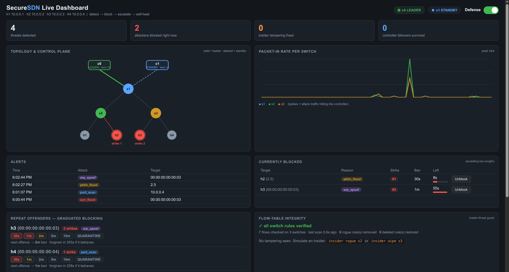
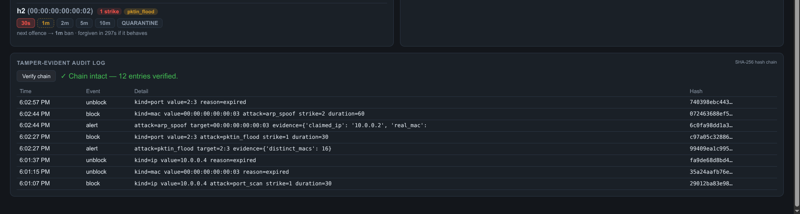

# SecureSDN

**A security framework for Software-Defined Networks (SDN).**
It detects attacks like SYN flood, port scan and ARP spoofing, blocks the attacker, and keeps working if a controller crashes.

Built with **Mininet + Open vSwitch + Ryu (OpenFlow 1.3)**, a Flask live dashboard, and Python.





---

## Why this project exists

In an SDN, one program (the **controller**) makes the forwarding decisions for every switch.
That makes the controller the most valuable target in the network: flood it, spoof traffic past it,
or send it forged commands, and you can disrupt the whole network from one point.
SecureSDN has two jobs:

1. **Detect and block attackers inside the network.**
2. **Protect the control plane itself** (commands, rules, controller availability).

## Features

| Layer | What it does |
|---|---|
| **Detect + block** | `syn_flood`, `port_scan`, `pktin_flood` (random-MAC control-plane DoS) and `arp_spoof`. Each attack has its own signature; The controller raises an alert and installs a drop rule for the offender (a MAC, an IP or a switch port, depending on the attack), with a timeout. |
| **Graduated blocking** | Repeat offenders climb a ladder: 30 s → 1 m → 2 m → 5 m → 10 m → **quarantine** (until an admin unblocks). Strikes follow the *host* across attack types and are forgiven after 5 min of good behaviour. |
| **Controller failover** | Two controllers run at once (`c0` primary, `c1` standby) with lease-file leader election and OpenFlow MASTER/SLAVE roles. If the leader dies, the standby takes over in about 3-4 s; active bans and strike counts survive. Drop rules stay in the switches, so attackers remain blocked during the gap. |
| **Flow-table integrity checker** | Every 3 s the leader compares each switch's real flow table with what it installed. A rogue rule (an insider running `ovs-ofctl add-flow`) is alerted and removed; a deleted critical rule is alerted and restored. |
| **Signed admin commands** | Block/unblock/defense-toggle commands are HMAC-SHA256 signed with a timestamp and nonce (replay protection). |
| **Tamper-evident audit log** | Every security event is appended to a SHA-256 hash chain; editing any past line breaks the chain and is caught by "Verify chain". |
| **Live dashboard** | Topology with controller roles, packet-in rate per switch, alerts, blocked hosts with countdown, escalation ladder, integrity panel, failover banner, audit log, Defense ON/OFF toggle. |

**Attacker types covered:** compromised/outsider host (4 attacks), failing controller (failover), insider with switch access (integrity checker).

## Architecture

```
        c0 (leader) ─┐  c1 (standby)        two controllers, one elected leader
                     s1                      (both connected to every switch)
                /         \
              s2           s3
             /  \         /  \
            h1   h2     h3    h4            h1 = victim, h2 = client, h3 = attacker
```

| Component | File |
|---|---|
| Controller (Ryu, OpenFlow 1.3) | `controller/secure_controller.py` |
| Detection signatures | `controller/security/detector.py` |
| Blocking + escalation ladder | `controller/security/blocker.py`, `escalation.py` |
| Leader election / failover | `controller/security/ha.py` |
| Flow-table integrity checker | `controller/security/integrity.py` |
| HMAC commands, audit chain | `controller/security/crypto_utils.py`, `audit_log.py`, `command_queue.py` |
| Admin API (port 5050) / Dashboard (port 5000) | `controller/admin_api.py`, `controller/dashboard_api.py` |
| Mininet topology + attack/insider commands | `topology/topo.py`, `attacks/` |

## How it works

### Detection signatures

Each attack has its own signature. Thresholds are in `controller/security/detector.py`.

| Attack | What the controller looks at | Signature | Blocked target |
|---|---|---|---|
| `syn_flood` | Initial SYNs per source MAC | Packet-in rate from one MAC above the threshold within a 2 s window | Source MAC |
| `port_scan` | Destination ports per source IP | One IP sends initial SYNs to many distinct ports within a short window | Source IP |
| `pktin_flood` | Source MACs seen on one edge-switch port | Many distinct MACs appear on one host-facing port within 2 s (trunk ports are excluded) | Switch port |
| `arp_spoof` | Sender fields of every ARP packet | The claimed IP-to-MAC binding contradicts the trusted table, which is seeded from the topology | MAC that sent the false ARP |

Only initial SYNs are counted. Otherwise the victim's own reply packets would make it look like the attacker.

### Response

1. The detector raises an alert and the controller installs a **drop rule** for the offender in the switch, with a timeout.
2. Because the rule lives in the switch, the attacker's later packets never reach the controller again.
3. The ban length comes from the escalation ladder (30 s → … → quarantine).
4. Every alert, block, unblock and failover is written to the hash-chained audit log.

## Tech stack

Python 3.9 · Ryu (OpenFlow 1.3) · Mininet · Open vSwitch · Flask · Scapy · hping3 · nmap · iperf3

## Testing

* `bash scripts/test.sh` runs 15 offline unit tests (escalation ladder, blocker, flow-table integrity checker, ARP-spoof detector, leader election and failover, command queue, audit-chain tamper detection). No Mininet needed.

## Requirements

* **Linux** (developed and tested on Ubuntu 24.04). Mininet needs root and kernel network namespaces,
  so this does **not** run on Windows/macOS natively. Use a Linux machine or a Linux VM.
* `sudo` access, about 2 GB RAM, and internet access for the one-time setup.

## Setup (one time)

```bash
git clone https://github.com/Jatin-Virmani/SecureSDN.git
cd SecureSDN
chmod +x scripts/*.sh
bash scripts/setup.sh        # installs Mininet, Open vSwitch, hping3, nmap, iperf3; creates a Python 3.9 venv with Ryu
bash scripts/smoke_test.sh   # checks that ryu-manager and the Python packages work
bash scripts/test.sh         # optional: 15 offline unit tests (no Mininet needed)
```

On first run, an HMAC key for admin commands is created in `certs/` (git-ignored).

## Run (4 terminals, in this order)

```bash
sudo mn -c                      # once, before starting: cleans leftover Mininet state
                                # (do NOT run it again while the controllers are running)

bash scripts/run_c0.sh          # terminal 1: primary controller (OpenFlow port 6653)
bash scripts/run_c1.sh          # terminal 2: standby controller (OpenFlow port 6654)
bash scripts/run_network.sh     # terminal 3: Mininet topology, then type:  pingall
bash scripts/run_dashboard.sh   # terminal 4: open http://127.0.0.1:5000
```

Single-controller mode also works: just don't start `c1`.

### Commands in the Mininet CLI

```
mininet> pingall                              # expect 0% dropped
mininet> attack syn_flood h3 h1 15            # attack <name> <attacker> <victim> <duration_seconds>
mininet> attack port_scan h3 h1 15
mininet> attack pktin_flood h3 h1 15
mininet> attack arp_spoof h3 h1 15            # attacker must not be h2 (h2 is the spoofed client)
mininet> insider rogue s2                     # insider plants a hidden black-hole rule on s2
mininet> insider wipe s3                      # insider deletes every rule on s3
```

The number at the end of `attack` is how long the attack runs, not how long the ban lasts.
Run `pingall` only when nobody is banned, otherwise a blocked host looks like a network outage.

### Failover demo

```bash
bash scripts/kill_leader.sh     # kill -9 on the current leader; the standby takes over
```

### Other helpers

```bash
bash scripts/verify_chain.sh                          # verify the audit-log hash chain from the CLI
python3 scripts/send_admin_command.py block ip 10.0.0.3
python3 scripts/send_admin_command.py defense off
```

### Tunable settings (environment variables)

| Variable | Default | Meaning |
|---|---|---|
| `DEFENSE` | `on` | Start with blocking enabled (`off` = detect and alert only) |
| `BLOCK_LADDER` | `30,60,120,300,600` | Ban lengths in seconds before quarantine (set the same for the dashboard) |
| `STRIKE_MEMORY` | `300` | Seconds of good behaviour before strikes are forgiven |
| `HA_LEASE` | `3` | Leader lease timeout in seconds (failover speed) |

Example: `BLOCK_LADDER=15,30,60 bash scripts/run_c0.sh`

## Project layout

```
attacks/            attack generators (hping3, nmap, Scapy) used by the Mininet CLI
controller/         Ryu controller, security modules, admin API, dashboard backend + UI
scripts/            setup, run, test and helper scripts
tests/              offline unit tests
topology/           Mininet topology + custom CLI commands
docs/screenshots/   dashboard screenshots
```

## Known limitations

* **Mutual TLS between switches and the controller is not implemented.** The OpenFlow channel is plain TCP on localhost.
* ARP detection trusts a static IP-to-MAC table seeded from the topology (similar in spirit to Dynamic ARP Inspection).
* Failover uses a lease file, so both controllers must run on the same machine; a real multi-host deployment would need a shared store such as etcd or ZooKeeper. Detection of a dead leader takes about 3 s, and the MAC-learning table is rebuilt afterwards (brief flooding).
* Integrity checker: after a failover the new leader adopts existing forwarding flows as its baseline, so an insider rule with exactly those priorities planted during that single scan would be adopted.
* The dashboard has **no authentication** and holds the key that signs admin commands. It binds to `127.0.0.1` only; do not expose it to a network.
* The attack scripts are meant for the Mininet test network only.

## Deployment note

The project needs Mininet, which creates virtual hosts and switches with Linux network namespaces and
Open vSwitch. That requires root and kernel features that web hosts (Vercel, Netlify, Render, GitHub Pages)
do not provide. To see it in action, run it locally with the steps above.

## License

MIT, see [LICENSE](LICENSE).
